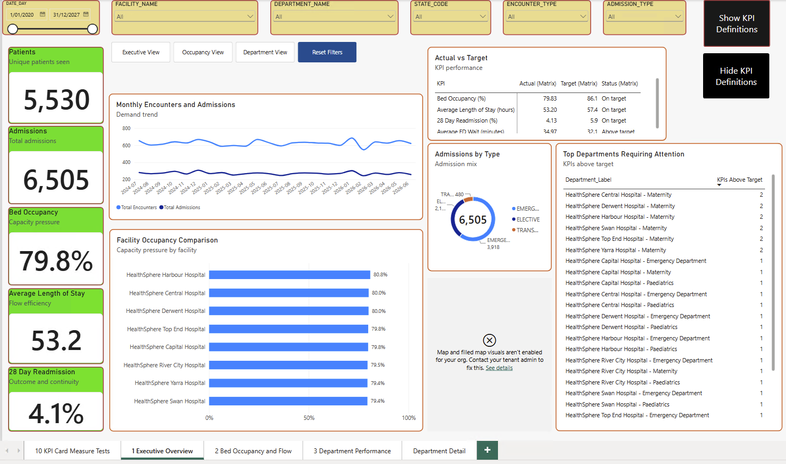
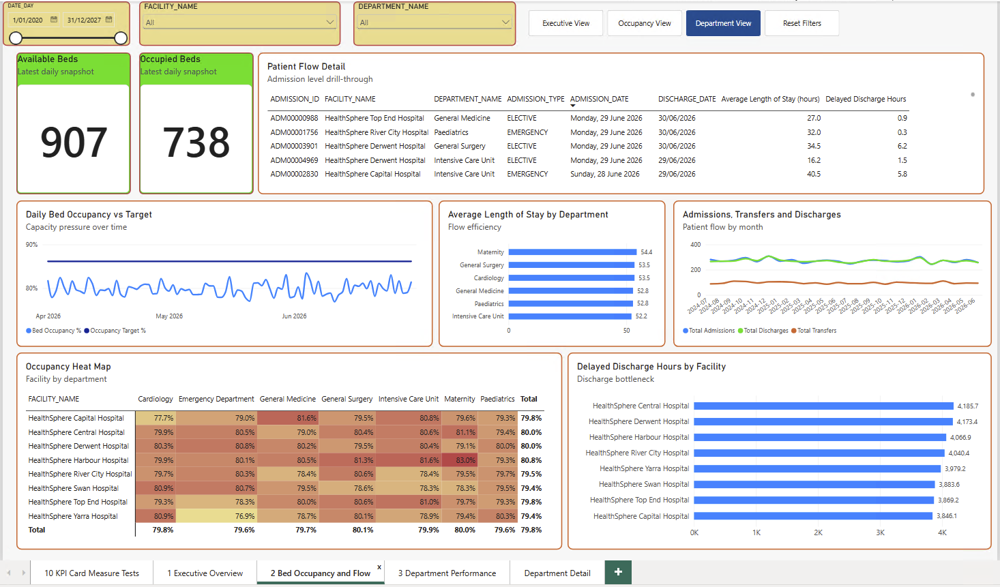
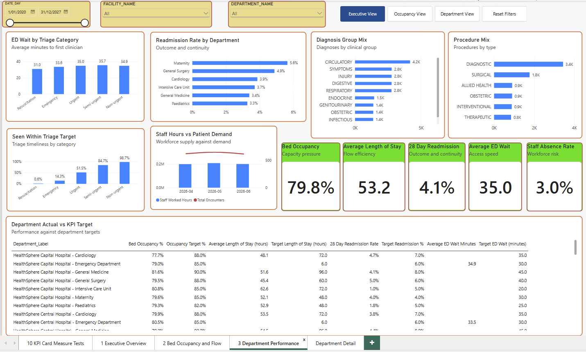
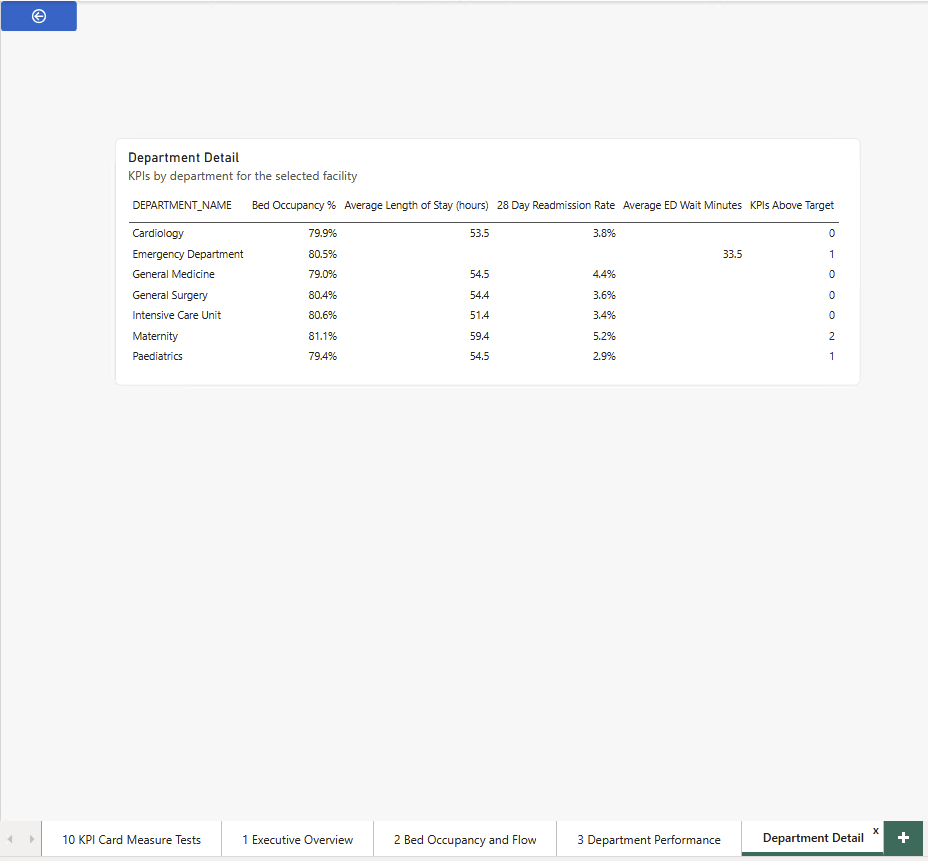

# Australian HealthSphere: Hospital Operations Analytics

An end-to-end data engineering project that builds a hospital operations dashboard for a fictional network of eight HealthSphere hospitals across Australia.

## Tools

Azure SQL, Azure Data Lake Storage (ADLS), Azure Data Factory (ADF), Snowflake, dbt Core, Power BI

## Data flow

Source data in Azure SQL and files in ADLS are loaded into Snowflake by Azure Data Factory. dbt Core then transforms the data into the `MART` schema, and Power BI reads from the mart tables.

## Mart tables

- **Dimensions:** `DIM_BED`, `DIM_DATE`, `DIM_DEPARTMENT`, `DIM_FACILITY`, `DIM_PATIENT`, `DIM_TRIAGE_CATEGORY`
- **Facts:** `FACT_ADMISSION`, `FACT_DAILY_OCCUPANCY`, `FACT_DEPARTMENT_TARGET`, `FACT_DIAGNOSIS`, `FACT_ED_TRIAGE`, `FACT_ENCOUNTER`, `FACT_PATIENT_TRANSFER`, `FACT_PROCEDURE`, `FACT_STAFF_ROSTER`

## Dashboard

The Power BI report has three dashboard pages and a department drill-through page.

### Executive Overview

### Bed Occupancy and Flow

### Department Performance

### Department Detail (drill-through)

## Data quality and validation

Every number on the dashboard was tied out to the Snowflake mart tables. The results, the fixes made along the way and the known data limits are in the tie-out note:

- [Power BI tie-out note (Markdown)](docs/powerbi_tieout.md)
- [Power BI tie-out note (PDF)](docs/powerbi_tieout.pdf)

## Project contents

| Folder | What it holds |
|---|---|
| `healthsphere_dbt/` | dbt Core project (staging, intermediate and mart models, tests) |
| `powerbi/` | Final Power BI report (`.pbix`) |
| `docs/` | Tie-out note and dashboard screenshots |

## Known data limits

- Bed occupancy and staff roster data cover 1 April 2026 to 30 June 2026 only. Admissions, encounters and ED wait cover July 2024 to June 2026.
- Department targets apply to every date range, because the dashboard ignores their effective dates.
- 22 admissions have no discharge date and count as current inpatients.
